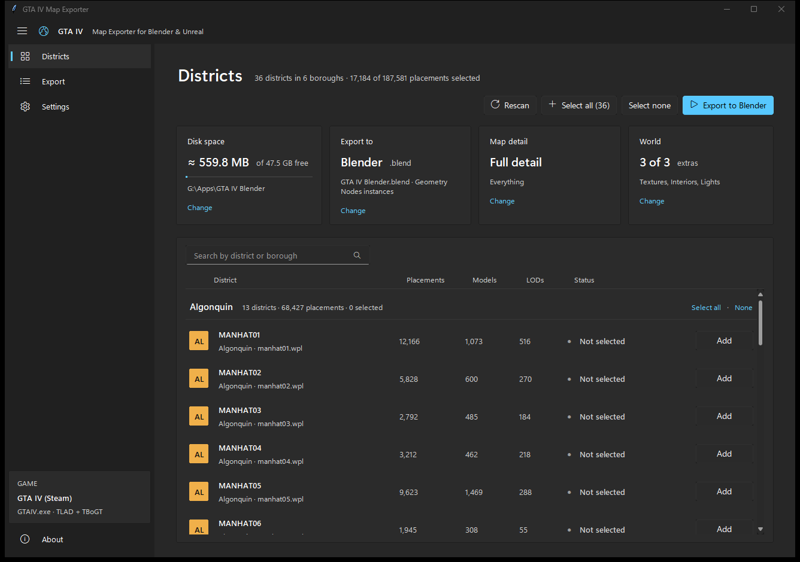
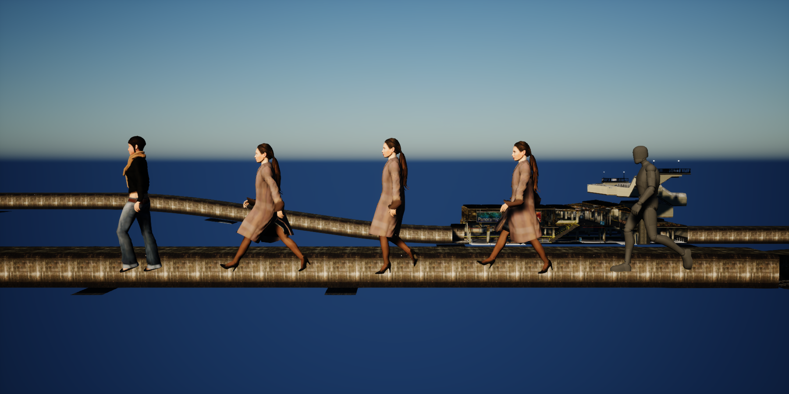
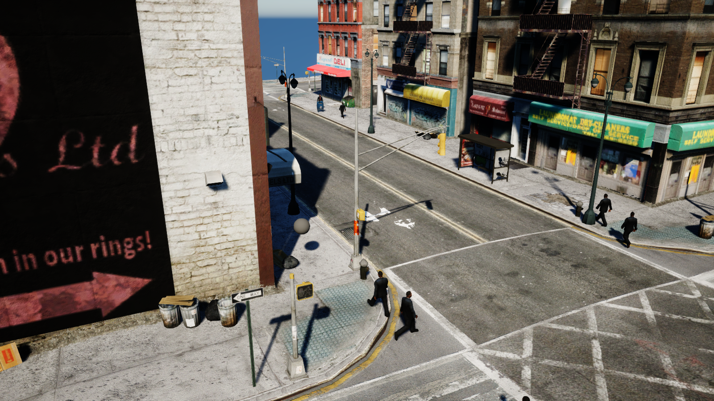

# GTA IV Exporter

Export Liberty City straight from your own GTA IV install to **Blender** or **Unreal Engine 5**:
the whole map with textures, interiors and working lights, plus (in Unreal) traffic, pedestrians,
every ped model, Niko and the weapons. No OpenIV and no pre-extracted files are needed.



> **No game files are included.** The tool reads the game you already own. It also doesn't ship
> GTA IV's encryption key: it finds the key inside your own `GTAIV.exe` and checks it against a
> SHA-1 hash.

## Features

**Map**
- Every district (Algonquin, Alderney, Broker, Dukes, Bohan), chosen one by one or all at once.
- Five detail levels, from full detail down to GTA's own far LOD models. Lower levels run much
  faster, for example in skate.
- Building interiors (MLO), placed where the game puts them.
- Materials set up properly:
  - opaque, alpha-masked (fences, foliage), glass and decal surfaces;
  - glowing emissive surfaces (lamp bulbs, lit windows);
  - night-only glow.

**Lights**
- Every street lamp, window and sign light from the game's 2D effects (2dfx).
- Blender: one light collection per district, plus a night switch for the glowing materials.
- Unreal: `BP_GTAIV_Lights` turns each district's lights on and off.
  - It works in the editor and in game, with automatic day/night that follows the sun.
  - Lights include GTA-style coronas (glow sprites).
  - Distant traffic lights glow along the highways.

**Traffic (Unreal)**
- GTA IV's road network and traffic cars, with wheels and the game's paint colours.
- Cars use lanes, keep their distance from the car ahead (IDM car-following) and take turns at
  junctions.
- They stop for the player.
- Cars spawn and despawn around the player.

**Characters (Unreal)**
- All 345 peds in their default outfits, plus Niko (from `playerped.rpf`), on one shared skeleton
  that faces Unreal's way with its feet at the origin.
- 79 weapons and held items as static meshes.
- **Game Animation Sample (GASP) projects** also get:
  - `BP_GTAIV_Ped`: a GASP visual override showing a random GTA IV ped, animated by GASP's motion
    matching through an IK retargeter.
  - `GM_GTAIV`: GASP's game mode with that override turned on. The player is Niko and NPCs are
    random peds.
  - Pedestrians walking the sidewalks of every street.
  - Nothing of GASP's own is modified; everything goes under `/Game/GTAIV`.




## Requirements

- Windows 10/11 and **GTA IV** or **GTA IV: The Complete Edition** (Steam, Rockstar or retail).
  `GTAIV/update` files take priority, so Fusion Fix overrides are respected.
- For Blender: **Blender 4.2+**.
- For Unreal: **Unreal Engine 5** (developed on 5.8).
  - The traffic/pedestrian plugin ships prebuilt for 5.8. For other versions, rebuild it from
    `UnrealPlugin/GTAIVTraffic`.
  - The character animation setup needs a project based on the **Game Animation Sample**.
- Disk space: the full city is about 3.6 GB in Blender and about 9 GB in Unreal. The app shows an
  estimate before you export.

## Using the app

1. Run `GTA IV Exporter.exe` (keep it next to its `_internal` folder). From source, run
   `GTA IV Exporter.pyw` instead.
2. **Settings**:
   - Check the GTA IV folder (found automatically on most machines).
   - Choose **Blender** (a `.blend` file) or **Unreal Engine** (a level in a `.uproject`).
   - Pick the detail level and what to include: textures, interiors, lights, traffic, characters.
3. **Districts**: pick what to export. The cards show the size estimate and free disk space.
4. Click **Export**. Progress and the log are on the **Export** page. When it's done, use
   **Open in Blender** / **Open in Unreal**.

For Unreal:
- Close Unreal Editor first.
- Everything goes into `Content/GTAIV` in that project. The import runs headless in several
  passes, so a big city doesn't run out of memory. An interrupted export resumes where it stopped.
- With Traffic or Characters on, the `GTAIVTraffic` plugin is copied into the project and enabled
  in the `.uproject`. The original is backed up as `.uproject.bak`.
- In the level:
  - `GTAIV_Traffic` and `GTAIV_Peds` actors control traffic and pedestrians (`MaxCars`, `MaxPeds`,
    spawn radius and more).
  - Each district's `BP_GTAIV_Lights` actor has `LightsOn` and `AutoDayNight` settings.

### Blender add-on only

`dist/gtaiv_exporter_addon.zip` installs as a normal add-on: *Edit → Preferences → Add-ons →
Install from Disk*. Then use *File → Import → GTA IV Map (game folder)*. See
[`gtaiv_exporter/README.md`](gtaiv_exporter/README.md).

## Building from source

```bat
build_exe.bat
```

This installs PyInstaller, numpy, pycryptodome and sv-ttk if they're missing, then builds:
- `dist/GTA IV Exporter/GTA IV Exporter.exe`
- `dist/gtaiv_exporter_addon.zip`

To run from source you need Python 3.10+ with `numpy`. `pycryptodome` makes decryption faster and
`sv-ttk` gives the Windows 11 look; both are optional.

The Unreal plugin is rebuilt with Unreal's `RunUAT BuildPlugin`:

```bat
"C:\Program Files\Epic Games\UE_5.8\Engine\Build\BatchFiles\RunUAT.bat" BuildPlugin ^
  -Plugin="%CD%\UnrealPlugin\GTAIVTraffic\GTAIVTraffic.uplugin" ^
  -Package="%CD%\UnrealPlugin\GTAIVTraffic_Built" -TargetPlatforms=Win64
```

## Project layout

| Path | What it is |
|---|---|
| `gtaiv_exporter_gui.py`, `fluent.py` | The desktop app (Tkinter, Windows 11 "Fluent" look) |
| `gtaiv_exporter/` | Game file readers + the Blender add-on |
| `blender_runner.py` | Runs inside Blender (headless) to build the `.blend` |
| `unreal_runner.py`, `unreal_lights.py`, `unreal_peds.py` | Run inside Unreal Editor (headless) to import assets, build the lights Blueprint, and set up the characters/GASP assets |
| `UnrealPlugin/GTAIVTraffic/` | C++ plugin: traffic manager, traffic cars, pedestrian manager |
| `build_exe.py`, `build_exe.bat` | Packaging |

### Game formats handled (`gtaiv_exporter/`)

| File | Reads |
|---|---|
| `img.py`, `rpf.py`, `aes.py` | IMG v3 and RPF2 archives (AES-encrypted tables of contents) |
| `rsc.py` | RSC05 resources (zlib, system/graphics segments) |
| `drawable.py` | `.wdr` / `.wdd` / `.wft` models, including skinned geometry |
| `texture.py` | `.wtd` texture dictionaries, with its own DXT1/3/5 decoder |
| `mapdata.py` | `gta.dat`, IDE definitions (including MLO interiors and 2dfx lights), binary WPL placements, `distantlights.dat` |
| `roads.py` | `paths.img` road network (`nodes*.nod`) |
| `vehicles.py` | `vehicles.img`, `vehicles.ide`, `carcols.dat` |
| `peds.py` | `componentpeds.img` peds, `playerped.rpf` (Niko), weapons, the 80-bone skeleton |
| `blender_import.py`, `unreal_export.py` | Blender scene building / glTF + JSON export for Unreal |

## Notes and limitations

- Characters are exported in their default outfit only. Pedestrians walk along the street curbs;
  GTA's own pedestrian navmeshes aren't used.
- The plugin binaries are built for Unreal 5.8.
- Unreal asset paths (`/Game/GTAIV/...`) and the plugin name `GTAIVTraffic` are fixed. Re-exporting
  updates them in place.

## Disclaimer

Fan-made tool, not affiliated with or endorsed by Rockstar Games or Take-Two Interactive.
Grand Theft Auto and GTA IV are their trademarks. Use it with a legally owned copy of the game, and
don't redistribute the exported game assets.

## Author

Made by **WackyHacky**.
